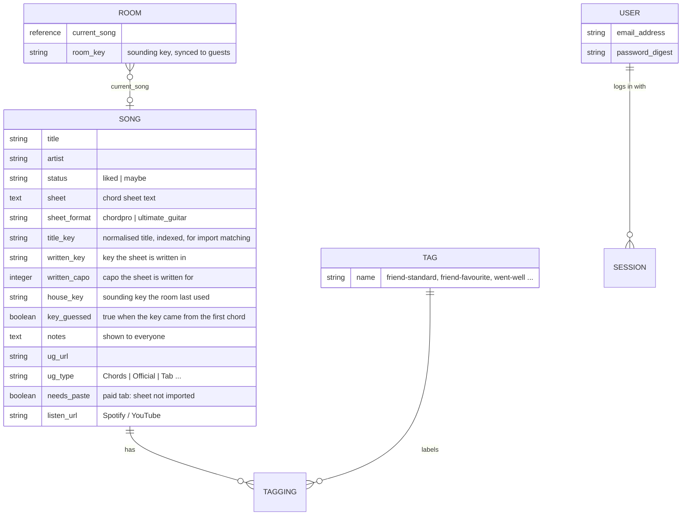
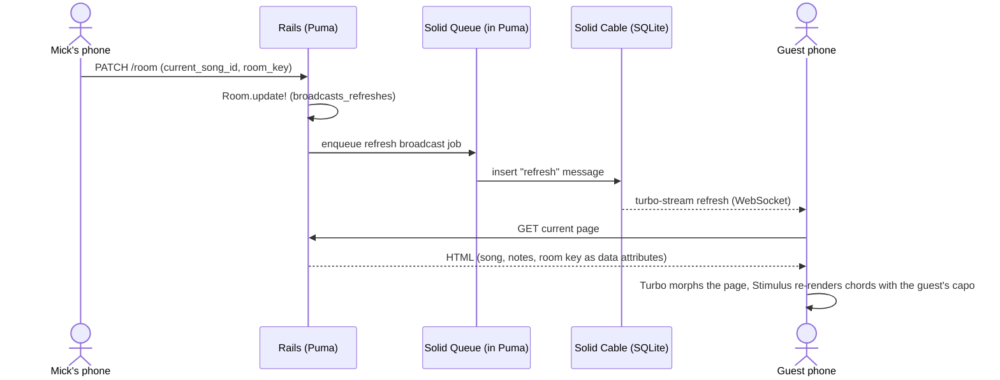

# Jambook: design

Jambook, a songbook for house jams. Live at `jam.mickzijdel.com`. MIT licensed.

Status: approved by Mick, 2026-10-30.

## 1. What this is and why

Mick hosts jam sessions at his house. Guests play and sing along from their own phones. Today the songs live in spreadsheets (a friend's jam lists) and in Mick's Ultimate Guitar (UG) saved tabs, and each person looks up their own chord sheet. That means ads, paywalls, different versions in different keys, and nobody knows which song is on.

The songbook is a small self-hosted web app that fixes that:

- **One list of songs**: the ones Mick likes and the ones that might work, gathered from his UG saved tabs and a friend's lists.
- **One chord sheet per song**: the version Mick prefers, hosted in the app.
- **Mick runs the room**: he pushes "now playing" and the room key from his phone, and every guest's screen follows.
- **Each guest keeps their own capo**: when Mick changes the key, everyone's chords move, and each guest's capo stays put.
- **Notes per song**, which everyone sees and Mick can edit mid-song.

Success: at a jam, Mick taps a song, and within a second every guest's phone shows it in the room key, in shapes that suit their own capo, with no app install and no account.

## 2. People and moments

| Who | When | What they do |
|---|---|---|
| Mick (host) | Before a jam | Curates songs, picks the chord sheet version, sets status and notes, imports lists |
| Mick (host) | During a jam, on his phone | Pushes the current song, changes the room key, edits the note for the current song |
| Guest | During a jam, on their phone | Opens the link, types the shared password once, follows along, sets their capo |
| Guest | Any time, from anywhere | Browses the song list and chord sheets (behind the same password) |

## 3. Goals, non-goals, anti-goals

**Goals**
1. Song list with status (*liked* / *maybe*) and source tags, searchable on a phone.
2. One hosted chord sheet per song, rendered in the browser, readable on a phone.
3. Live "now playing", pushed by the host to every connected guest.
4. Synced room key with a per-guest, per-song capo offset (§6.5).
5. Per-song notes, visible to everyone and editable live by the host.
6. Import from: Mick's UG saved tabs, CSV song lists (a friend's sheets), pasted chord text (paid tabs and anything else).
7. Deployed with Mick's usual Kamal setup, behind a shared guest password.
8. Ready to open-source: no personal data, server details or copyrighted lyrics in the repo.
9. Installable as a PWA: guests and Mick can add it to their home screen and open it full-screen like an app.

**Non-goals (v1)**
- Guest song requests or voting (decided out loud in the room).
- Guest accounts, guest editing.
- Synced scrolling or autoscroll.
- Setlists, a played-songs history, chord diagrams, offline mode, PDF export, native apps, audio.
- Multiple rooms or running it as a hosted multi-user service: one install per host.

**Anti-goals** (failures even if everything "works")
- A guest has to sign up or install something to follow along.
- A guest's capo resets or gets overridden when Mick changes the key.
- Mick has to use a laptop mid-jam: every host action works one-handed on a phone.
- The app automatically pulls content out of UG's paid (Pro/Official) tabs.
- Personal data, Mick's server details or copyrighted lyrics end up in the public repo or its history.

## 4. Constraints

- **Stack (Mick's call):** Rails 8.1, scaffolded with `rails new` (the CLI, not hand-written files), SQLite, Hotwire (Turbo + Stimulus), importmap. Then the usual dev-env setup (mise, hk, gitleaks).
- **Hosting (Mick's call):** his usual Kamal setup: an image on ghcr.io, his own server, kamal-proxy with Let's Encrypt, SQLite on a volume, Solid Queue inside Puma.
- **Access (Mick's call):** reachable from anywhere, behind a password, because the chord sheets contain copyrighted lyrics (UG licenses lyrics from publishers).
- **UG has no official API.** Public tab pages embed their data as JSON (§6.7). Paid tabs are not in the page without a paid login.
- **Open source later (Mick's call):** design for it from the first commit. License: MIT.

## 5. Approaches considered

| Approach | Trade-off | Verdict |
|---|---|---|
| **A. Rails app like Mick's others** | Most code of the three, but it matches his other apps (deploys, secrets, pre-commit) and he loves Rails | **Picked by Mick** |
| B. Song files (ChordPro) in a git repo plus a small live server | Less code, but every song or status edit is a file edit and a deploy; a second stack to maintain | Dropped |
| C. Adopt an existing app | Closest is [Gigboy](https://github.com/blindpassasjer/gigboy) (Apache-2.0, React + Express + Postgres): leader-driven "Concert Mode", per-member notes, pasted UG import. But every follower needs an account (invite-only), a personal capo while following isn't documented, and it doesn't import saved-tab lists. [Chordvault](https://github.com/rusahu/Chordvault) has no live sync; [ChordBand](https://github.com/ujwal0909/ChordBand) runs on Firebase. | Dropped: guest access without accounts is the core of a house jam, and adding it to Gigboy means reworking its login system in a stack Mick doesn't use |

## 6. Design

### 6.1 Data model

- `Room` is a single row (`Room.instance`). It holds the live state.
- The sheet's written key and written capo are columns, not directives inside the sheet, because UG-format text has nowhere to hold them. The renderer applies them with `setKey`/`setCapo` and ignores any `{key}`/`{capo}` directives in the text; the editor copies such directives into the columns when Mick pastes a sheet.
- `house_key`: the sounding key used the last time the song was played. It is set from the sheet on import; when Mick changes the room key during a song, the new key is saved here too *(my call, from the transpose design Mick approved)*.
- **Builder's call:** tags as `Tag` + `Tagging` tables (shown), or a JSON column. Either is fine.

### 6.2 Access

- **Guests:** one shared password. On success, set a signed, long-lived cookie (30 days). The password is stored as a digest in a settings row that the host can change on a settings page *(my call: friendlier for other people self-hosting it than an environment variable)*. Rate-limit the password form with Rails 8 `rate_limit`.
- **Host:** the Rails 8 authentication generator (`bin/rails generate authentication`), one user created from the console or a seed task. The host is also a guest.
- Guests can read everything and set their own capo. Only the host can push, change the key, edit notes, edit songs and import.
- All pages, including chord sheets and the Action Cable connection, require at least the guest cookie. Add `noindex` headers.

### 6.3 Pages

| Page | Who | Contents |
|---|---|---|
| **Live** (`/`) | Everyone | The current song: title, room key, notes, chord sheet, capo control. Host extras: key −/+ buttons, edit-note button, "pick next song". Requests a screen wake lock so phones stay on. |
| **Songs** (`/songs`) | Everyone | Search plus filter by status and tag; marks the now-playing song. Host extra: "Play now" on each row. |
| **Song** (`/songs/:id`) | Everyone | The same chord view, in the song's `house_key` (not synced). A sticky "Now playing: X, tap to join" banner whenever the song isn't the current one. Host extras: "Play now", edit. |
| **Edit song** | Host | Fields from §6.1; chord sheet editor: paste text, choose or auto-detect the format, live preview, save. |
| **Import** | Host | Upload a CSV song list or a UG bundle (§6.7); shows matched, created and needs-paste songs. |
| **Settings** | Host | Guest password. |
| **Password** | Guests | One field. |

Everything is phone-first: large type, high contrast, a dark theme by default (jams happen in the evening), and controls reachable with one thumb.

### 6.4 Live updates

- `Room` broadcasts a refresh **synchronously** after each update (`after_update_commit :broadcast_refresh`), and so do note and sheet edits on the current song. Synchronous broadcasts skip the job queue, so they don't depend on Solid Queue running and system tests see them. Every page subscribes with `turbo_stream_from Room.instance`, so the "Now playing" banner on other pages updates too.
- Page refresh method **morph**, scroll **preserve**. On a song change the chord controller scrolls to the top; on a key or note change the scroll position stays.
- The chord output element is `data-turbo-permanent` (so morphing doesn't wipe the browser-rendered chords) and re-renders on the `turbo:morph` event.
- **Re-sync:** broadcasts missed while a phone was asleep or offline are not replayed. A layout-level Stimulus controller re-fetches the page (`Turbo.session.refresh`) when the stream source regains its `connected` attribute and when the page becomes visible again.

**Spike-proven gotchas (keep these in the build):**
1. `turbo_refreshes_with` provides content for `:head`, so it must be called *before* `yield :head`. Placed after it, it silently outputs nothing and Turbo falls back to replacing the whole page, which breaks the chord redraw. Use `turbo_refresh_method_tag :morph` and `turbo_refresh_scroll_tag :preserve` directly in the layout.
2. `broadcasts_refreshes` and the other `_later` broadcasts go through Active Job: a change made from `bin/rails runner` or a console with the async adapter never reaches guests. Hence the synchronous broadcasts above.
3. Without the re-sync controller, a guest whose connection dropped stays on the old key with no sign that anything is wrong.

### 6.5 Transpose model (Mick approved)

Definitions:
- **Written key / written capo**: what the chord sheet is written in (e.g. Wonderwall from UG: Em shapes, capo 2).
- **Sounding key**: written key + written capo (Wonderwall sounds in F#m).
- **Room key**: the sounding key the room plays in. Synced from the host.
- **Viewer capo**: per guest, per song, stored in the guest's browser (`localStorage`, key `capo:<song_id>`, wrapped in try/catch). Defaults to the sheet's written capo, so by default each guest sees the shapes the sheet was written in.

Displayed chords = sheet → `decapo()` (to sounding) → `changeKey(room key)` → `transpose(-viewer capo)`.

The status line on each guest's screen reads: "Room key F#m · your capo 2 · Em shapes". Capo −/+ buttons change only that guest's view.

Spike results (ChordSheetJS 18.0.0, UG Wonderwall chords):

| Room key | Viewer capo | Chords shown |
|---|---|---|
| F#m | 2 | Em G D A7sus4 |
| F#m | 0 | F#m A E B7sus4 |
| Gm | 3 | Em G D A7sus4 |
| Gm | 0 | Gm Bb F C7sus4 |
| Ebm | 1 | Dm F C G7sus4 |

**Missing keys:** many UG tabs have no key. ChordSheetJS throws "Cannot change song key, the original key is unknown". On import, set the key from the first chord and mark `key_guessed`; the edit page highlights this so Mick can confirm it.

### 6.6 Chord sheets

- **Library:** [ChordSheetJS](https://github.com/martijnversluis/ChordSheetJS) 18.0.0, pinned with `bin/importmap pin chordsheetjs@18.0.0` (one 404 KB minified ES module from jspm, no dependencies). It parses ChordPro, chords-over-lyrics and UG format, transposes, and renders HTML (`HtmlDivFormatter`).
- **Storage:** `sheet` + `sheet_format`. Bulk-imported UG sheets are stored as UG text, with the `[ch]`/`[tab]` markup stripped, plus `{key}`/`{capo}` metadata; the browser parses them with `UltimateGuitarParser` at render time. When the host saves the edit form, the browser converts the sheet to ChordPro and saves it as `chordpro`. This keeps JavaScript off the server.
- **Spike result:** UG Wonderwall converted cleanly, with Intro and Verse sections recognised and chords placed above the right syllables.
- **Builder's call:** styling of the rendered sheet (chords above lyrics, section labels, line wrapping on narrow screens). Lines of pure tablature (`e|---3---`) render as plain text and aren't transposed; that's acceptable.

### 6.7 Importing

1. **CSV song list** (generic, for a friend's sheets and anyone else's): header row `title,artist,status,tags`, with tags separated by `;` inside the cell. Creates songs without a sheet, or adds tags to existing ones.
   - Mick's seed data: the builder writes a one-off script (scratchpad, never committed) that reads `the friend's spreadsheet (xlsx)` with cell formatting (openpyxl) and writes the seed CSV. All songs are status *maybe* unless also in his saved tabs.
     - Main list: bold → `friend-standard`, blue font → `friend-favourite`, every row → `friend-list`.
     - "canonical song list" → `friend-canonical`.
     - "other songs that have gone well" → `went-well`.
     - "speculative songs" → `speculative`.
     - The "past jam list" tab is skipped.
2. **UG saved tabs**, in three steps (plus a selection step: chord sheets only, one per song; *liked* unless UG rates the tab "advanced", then *maybe*):
   1. On UG's "My tabs" page, logged in, Mick runs a console snippet that collects every object with a `tab_url` from the page's embedded JSON and downloads `ug-saved-tabs.json`. **Not yet proven:** the structure of the My tabs page needs his login (see §9).
   2. A **laptop-side** task (`bin/rails ug:fetch[urls.txt]`, run on the laptop, not the server) takes a plain list of tab URLs, so only the snippet depends on UG's My tabs page structure. It downloads each *public* tab page and reads `store.page.data` from the page's `.js-store` element's `data-content` JSON (proven on a public page with plain `curl`). It takes the tab's song, artist, sounding key (`tonality_name`), capo (`tab_view.meta.capo`) and content (`tab_view.wiki_tab.content`), and writes a bundle JSON. Paid tabs (Official/Pro) are **not** fetched; they go into the bundle as `needs_paste` with their URL. One request per second.
   3. Mick uploads the bundle on the Import page.
   - Why on the laptop: UG sits behind Cloudflare, which often blocks server IP addresses (not checked for Mick's server), and it keeps scraping off the server.
3. **Paste:** any song's edit page accepts pasted chord text (UG copy, chords-over-lyrics or ChordPro). This is the fallback for paid tabs and the route for anything outside UG.
   - **Paid (official) tabs:** a saved official page holds only key, capo and tuning as text; UG's player draws the music on a canvas, so there is nothing to convert. Instead the fetcher looks the song up in UG's public search and imports the most-voted free Chords version, keeping the official URL for reference (spike: Ironic → a free version with 3,700 votes, rating 4.84). Mick can still paste UG's exact version by hand.
4. **Re-imports never overwrite Mick's work** *(my call)*: one sheet per song. An import only fills empty fields: it never replaces an existing sheet, notes or `house_key`; on a match it sets status to *liked* (UG imports) and adds tags. When several saved tabs match one song, it uses the first Chords-type tab and lists the others (type and UG link) in the import result, so Mick can paste a different one in. Tablature-only types create the song with `ug_url` and no sheet. The fetch task skips URLs already in its output file, so a failed run resumes where it stopped.
5. **Build order:** the UG path is built last, after the snippet output from Mick's real My tabs page is known (§9).
6. **Matching:** match imports to existing songs by normalised artist + title (lowercase, strip punctuation, `&` → `and`, "the " prefix, `aeroplane` → `airplane`, `pt.` → `part`, number words → digits). Unmatched rows create new songs. The import result lists what was created, matched and still needs a paste. **Builder's call:** no merge UI in v1; Mick deletes duplicates by hand.

### 6.8 PWA

- Rails 8.1 `rails new` already generates `app/views/pwa/manifest.json.erb` and `app/views/pwa/service-worker.js`, with the two routes and the manifest `<link>` commented out. Switch them on.
- Manifest: name "Jambook", `display: standalone`, `start_url: "/"` (the Live page), dark `theme_color` and `background_color`, icons at 192 and 512 px plus a maskable one *(builder makes a simple icon)*.
- Service worker: never cache HTML, because live pages must always come from the server. Cache only fingerprinted assets, or keep the generated worker as is. Offline mode stays a non-goal.
- An installed web app on iOS keeps its own cookies apart from Safari, so a guest who installs it types the password once more inside the app. Show a short "Add to home screen" hint on the Live page for iOS, which has no install prompt.

### 6.9 Hosting

- Rails 8.1 production defaults: SQLite databases for primary, cache, queue and cable on the Kamal volume; Solid Queue in Puma; Solid Cable polling at 0.1 s.
- Host: `jam.mickzijdel.com` on Mick's usual server.
- Kamal: `require_destination: true`. The committed `config/deploy.yml` has no server or host. Mick's own `config/deploy.<name>.yml` and `.kamal/secrets.<name>` are gitignored and sit beside the repo, the same pattern as booking-overview minus committing the destination file.
- `RAILS_MASTER_KEY` comes through fnox, as in his other apps; the fnox setup stays optional for other self-hosters.

### 6.10 Open-source readiness, from the first commit

- No personal data in git: song lists, saved tabs and bundles are uploaded at runtime; add `*.xlsx`, `ug-*.json` and `bundle*.json` to `.gitignore`.
- Test fixtures and demo seeds use public-domain songs only (House of the Rising Sun, Amazing Grace, Scarborough Fair).
- The UG fetch task is optional, documented as personal-use, off the main path; the app works fully with paste and CSV.
- README for self-hosters: what it is, Kamal deploy, creating the host user, setting the guest password.
- MIT license (`LICENSE` file from the first commit).

## 7. Spike log (2026-10-30, throwaway code in the session scratchpad)

| Spike | Result |
|---|---|
| UG public tab page fetch (laptop, curl) | 200; data in `.js-store`; chords marked `[ch]`; key and capo present |
| UG text → ChordPro (ChordSheetJS 18) | Clean, sections kept |
| Room key + viewer capo maths | Correct for all cases in §6.5, sharps and flats spelled correctly |
| Missing key | `changeKey` throws; needs a guessed key |
| ChordSheetJS via importmap | 404 KB minified ES module, no dependencies, loads in the browser |
| `rails new` (8.1.4) + Solid Cable on SQLite in development | Works |
| Two guests follow key, note and song changes | Yes, 0.3–0.9 s after the host's request; each guest's capo kept per song |
| Scroll | Kept on key and note changes, reset to the top on a song change |
| Dropped connection | Stale without re-sync; caught up in 0.25 s with it |
| Screen Wake Lock API | Present in Chromium |
| Paid (Official) tab page content | Not checked: the permission system blocked fetching it. The design doesn't depend on it |
| UG My tabs page structure | Not checked: needs Mick's login |
| UG fetch from Mick's server | Not checked: the import runs on the laptop instead |
| Wake lock on iOS Safari; WebSockets through kamal-proxy | Not checked in the spike; both are standard and checked at the first deploy |

## 8. Decisions so far

**Mick's:** name Jambook; `jam.mickzijdel.com`; MIT; installable PWA; paid tabs via an HTML page he saves himself; guests follow along on their own phones; host pushes now playing; synced room key with a per-guest capo offset; notes for everyone, editable live by Mick; no guest requests; reachable anywhere behind a password; Rails via `rails new`; SQLite; usual Kamal setup; "my list" = UG saved tabs; build our own rather than adopt Gigboy; prepare for open source; a friend's xlsx tabs only where useful.

**Mine** (for Mick to check): the guest password is changeable in settings; changing the room key updates `house_key`; the viewer capo defaults to the sheet's capo; the UG fetch runs on the laptop and skips paid tabs; a key guessed from the first chord when missing; dark theme by default; tags as join tables; no merge UI; re-imports only fill empty fields; the first Chords-type tab wins when several match; the builder converts a friend's xlsx.

## 9. Open questions for Mick

Answered: name (Jambook), hostname (`jam.mickzijdel.com`), license (MIT).

Also answered (2026-10-30): the My tabs page has no embedded data, so the snippet reads the rendered links (119 tabs); the official tab question is settled above.

Saved dates (re-run, 2026-10-30): all but one of the 104 chord sheets were saved in the last 16 months, so dates don't separate old from current; the type filter already drops the old bass save, and UG's difficulty rating decides *liked* vs *maybe*. No open questions remain.
